# 웨이퍼 측정 시퀀스 시뮬레이터

접촉식 4점 프로브 면저항 계측 장비의 **제어 시퀀스·처리량(Tact/UPH)·측정 데이터**를 가상 장치 위에서 재현하는 C#/.NET 10 데스크톱 시뮬레이터다. 엔진 하나를 WinForms(장비 HMI 표준 스택)와 Avalonia(맥 시연용) 두 화면이 공유한다. 모든 수치는 가상이며 특정 회사·장비의 값이 아니다.

[](https://github.com/Parkchenil/wafer-sequence-sim/actions/workflows/ci.yml)

## 왜 만들었나

장비 제어 소프트웨어의 핵심은 "웨이퍼 한 장이 왜 이만큼 걸리는가"를 로그로 쪼개고, 설정 하나를 바꿨을 때 어느 단계가 얼마나 줄어드는지 숫자로 보여 주는 일이라고 생각한다. 그 일을 실제 장비 없이도 연습하고 설명할 수 있는 도구가 필요했다. 그래서 장비를 모듈별 상태기계로 모델링하고, 레시피(대기 시간·접촉 방식·언로딩 중첩·저장 방식)를 바꾸면 Tact와 간트 차트가 어떻게 변하는지 보이는 시뮬레이터를 만들었다. C# WinForms는 이 프로젝트로 처음 썼고, 그 과정 자체를 포트폴리오에 담았다.

## 화면

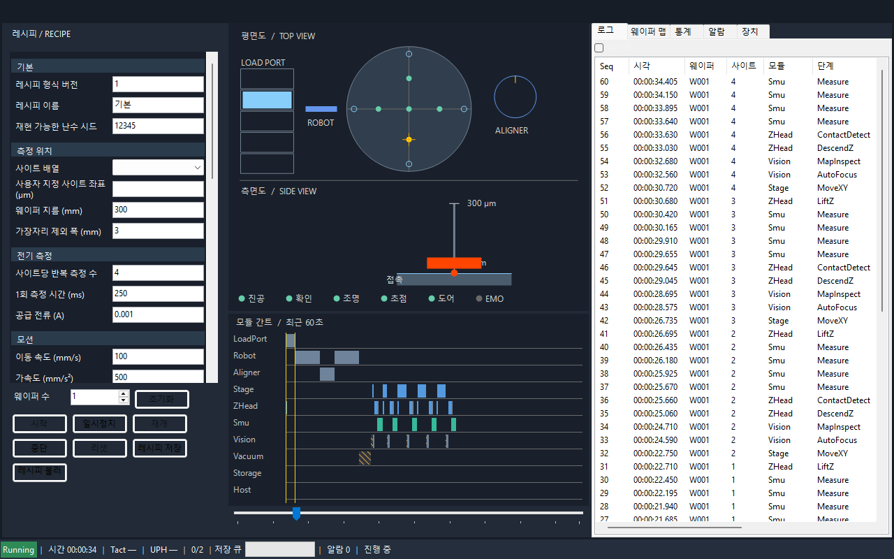

위는 GitHub Actions의 윈도우 러너가 WinForms 앱을 진짜 엔진으로 돌리다 첫 웨이퍼 네 번째 사이트를 측정하는 순간에 `DrawToBitmap`으로 저장한 화면이다(사람 손을 거치지 않은 캡처).

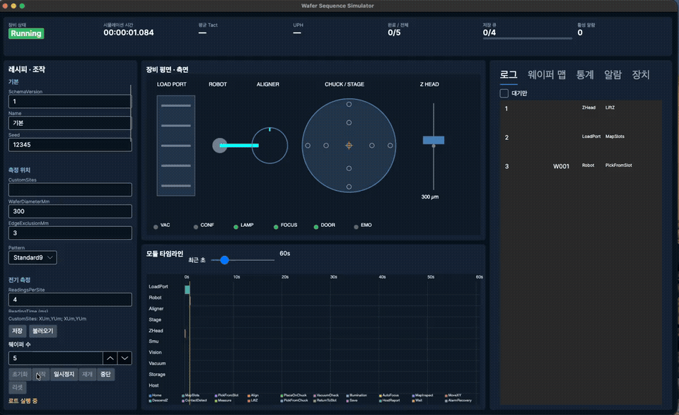

위는 맥에서 Avalonia 화면으로 로트를 시작한 직후 40초를 녹화한 것이다([mp4](docs/images/demo-avalonia.mp4)). 아래는 정지 화면이다.

| WinForms (CI 윈도우 러너가 헤드리스로 캡처) | Avalonia (맥에서 실행) |
| --- | --- |
| 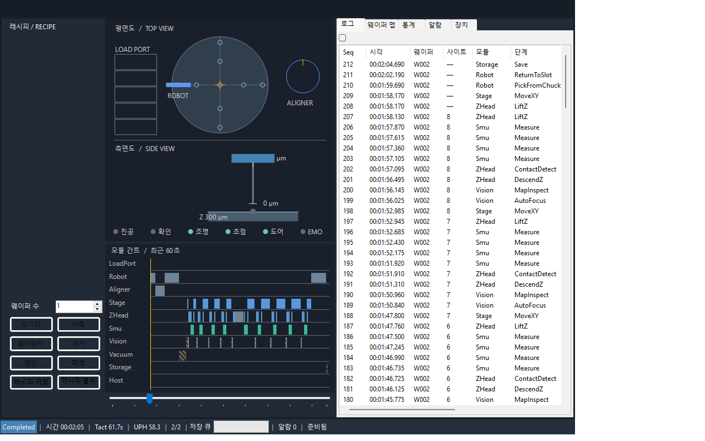 | 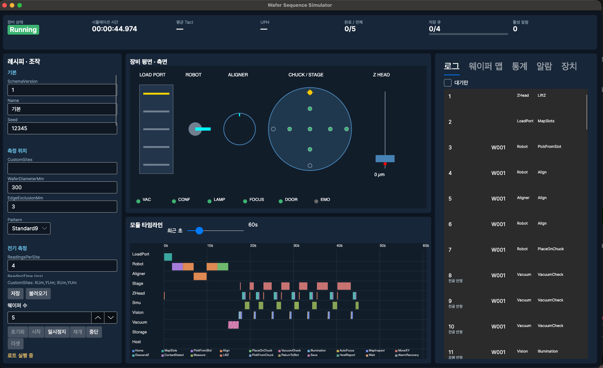 |
| 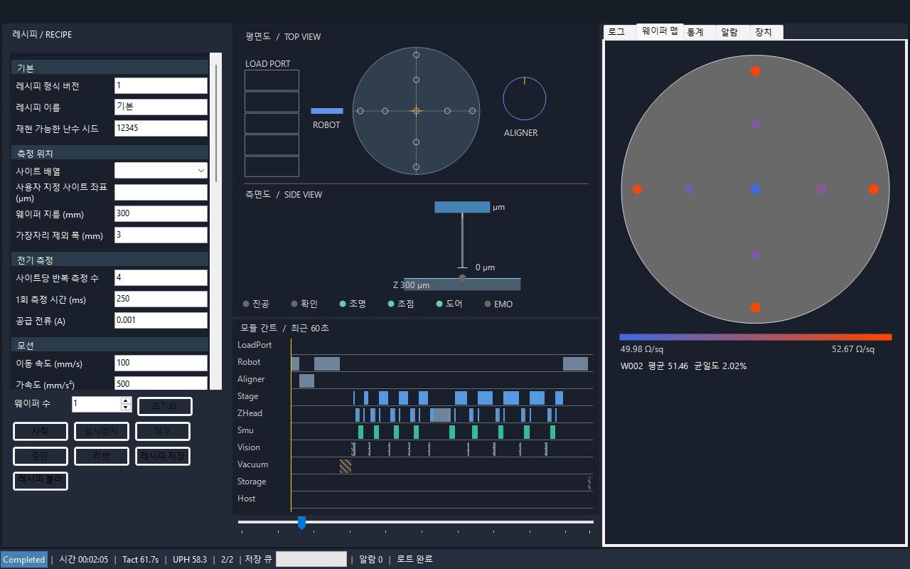 | 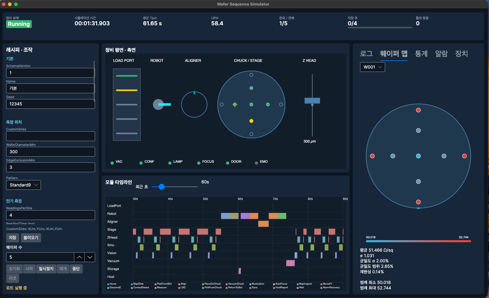 |
| 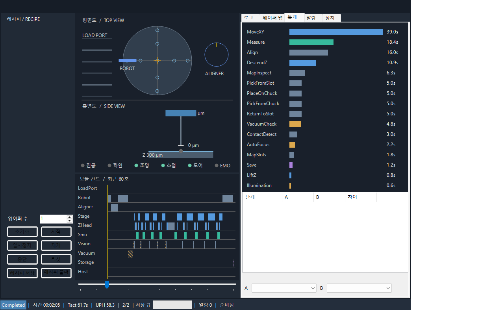 | 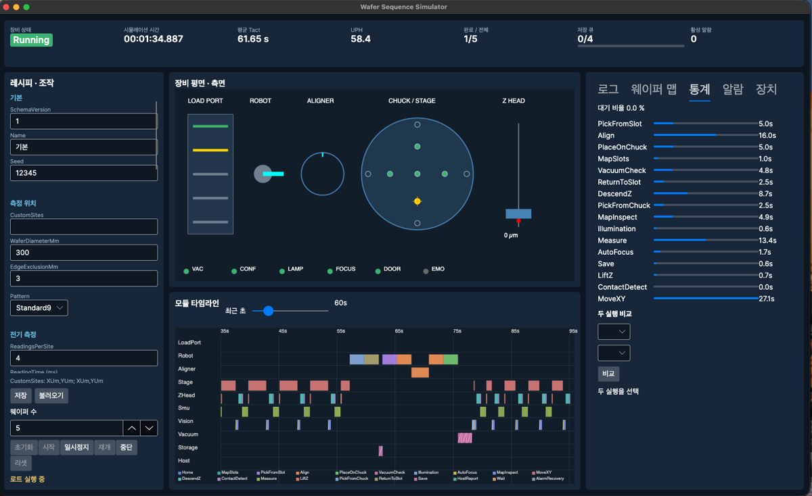 |

화면 구성은 둘 다 같다. 상단 지표(상태·시뮬레이션 시간·평균 Tact·UPH·진행·저장 큐·알람), 왼쪽 레시피·조작, 가운데 **2D 도식**(로드포트·로봇·얼라이너·척 위 측정 사이트·스테이지 십자선·Z 헤드 측면도·상태등)과 **모듈 간트 차트**(행=모듈, 막대=단계, 빗금=대기), 오른쪽 로그·웨이퍼 맵·통계(단계별 누적, 두 실행 비교)·알람(Ack)·장치 상태 탭이다.

## 무엇을 시뮬레이션하나

웨이퍼 1장은 `픽업 → 정렬 → 척 탑재 → 진공 확인 → 조명 → [사이트마다: XY 이동 → (오토포커스·맵 검사) → Z 하강 → 접촉 감지 → 전압 N회 측정 → 리프트] → 안전 높이 → 반출 ∥ 저장` 순서로 흐른다. 레시피로 바꿀 수 있는 것:

- 측정 위치 패턴(1/5/9/49점·사용자 정의), 사이트당 반복 측정 수와 1회 측정 시간
- 모션: 이동 속도·가속(사다리꼴 프로파일), Z 접근 방식(연속 하강 vs 스텝 하강), 사이트 사이 리프트 높이, 접촉 감지 타임아웃·재시도
- 고정 대기: 진공 확인 횟수·시간, 조명 안정, 오토포커스, 맵 검사 범위(전수 vs 첫 사이트만)
- 핸들링 중첩: 측정 중 다음 웨이퍼를 미리 정렬하고 반출과 저장을 겹친다
- 결과 저장: 동기(시퀀스가 기다림) vs 비동기 큐(용량·쓰기 시간)
- 시계: 실시간(배속) vs 즉시 계산

측정값은 가상 SMU가 SCPI 명령(`:SOUR:CURR`, `:MEAS:VOLT?`)으로 돌려주는 전압을 Rs = 4.532·V/I(가장자리 보정)로 계산한다. 분포 모델은 웨이퍼별 seed로 정해지는 방사형 분포 + 잡음이다. 웨이퍼마다 평균·σ·균일도 2종·재현성(같은 사이트 반복 σ)을 내고 컬러맵으로 그린다.

## 구조

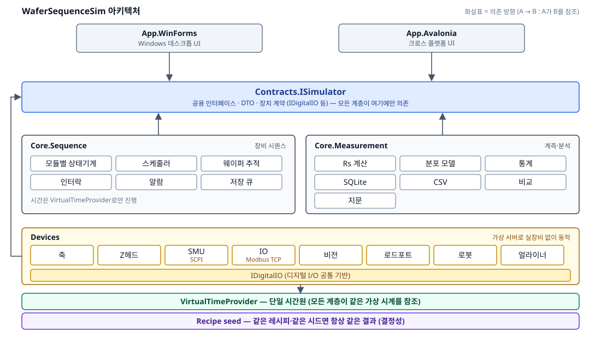

| 프로젝트 | 역할 |
| --- | --- |
| `src/Contracts` | 계약만. `ISimulator`, 장치 인터페이스, DTO, 알람 코드, 레시피, `VirtualTimeProvider`. 모든 프로젝트가 이것만 참조한다 |
| `src/Core.Sequence` | 시퀀스 엔진. 모듈별 상태기계 10개, 웨이퍼 추적, 자원 점유 스케줄러(파이프라인), 인터락, 알람·안전 상태·복구, 저장 큐(역압), 단계 로그·통계 |
| `src/Core.Measurement` | Rs 계산·가장자리 보정, 면저항 분포 모델, 측정 패턴, 통계·재현성, SQLite 이력, 실행 비교, 레시피 JSON, CSV, 로그 지문 |
| `src/Devices` | 이름 붙은 IO 포인트(`IDigitalIO`) 위의 장치: 축(사다리꼴 프로파일·소프트 리밋·홈잉), Z 헤드 접촉 커플링, SCPI 가상 SMU, **Modbus TCP**(FC1/3/5/6/16 직접 구현) 가상 PLC, 비전·로드포트·로봇·얼라이너, `WaitFor(조건, 타임아웃, 알람코드)` |
| `src/App.WinForms` | C# WinForms HMI. GDI+ 도식·간트·맵. `--screenshot` 헤드리스 캡처(CI) |
| `src/App.Avalonia` | 같은 화면을 Avalonia로. 맥 실행·시연용 |
| `tests/Tests` | xUnit 131건: 시퀀스(결정성·역압·중첩·알람 복구·인터락·EMO·Pause/Abort·RunId), 측정, 장치(프로파일·커플링·SCPI·Modbus TCP·seed), 조립 통합(인메모리·프로토콜·실시간 경로) |

## 설계 결정

1. **모듈별 상태기계와 스케줄러.** 장비 상태를 열거형 하나로 두면 "언로딩 중첩" 같은 동시 동작을 표현할 수 없다. 로드포트·로봇·얼라이너·스테이지·Z 헤드·SMU·비전·진공·저장·호스트가 각자 상태를 갖고, 척·로봇·얼라이너는 자원으로 점유·해제한다. 장비 전체 상태는 모듈 상태에서 계산한다.
2. **시간원은 하나, 난수는 seed에서만.** `DateTime.Now`·`Stopwatch`·`Task.Delay(ms)`를 금지하고 `VirtualTimeProvider` 하나로만 기다린다. 즉시 모드는 가상 타이머 큐를 가장 이른 순서로 발화시켜 겹친 동작은 겹친 만큼만 시간이 흐른다. A/B 실험은 단일 실행 큐에서 같은 레시피+seed의 로그 지문(SHA-256) 재현성을 검증한다. 일반 live Instant 경로에는 기존 스레드풀 스케줄링의 변동 가능성이 있다.
3. **측정값은 절대 버리지 않는다.** 비동기 저장 큐가 가득 차면 시퀀스가 `Wait(저장 큐 가득)`로 멈추고, 그 대기가 간트에 보인다. 처리량을 올리려다 데이터를 잃는 쪽보다 느려지는 쪽을 택했다.
4. **인터락은 시퀀스 if문이 아니라 명령 계층에.** XY 이동·Z 하강·로봇 진입·진공 해제 직전에 `IInterlock`이 사유와 함께 거부한다. 알람이 나면 Z 상승·축 정지의 안전 상태로 가고, 운영자 Ack → Reset → 재초기화 경로를 탄다.
5. **IO 포인트 추상화 위에 장치와 프로토콜.** 가상 장치도 실제처럼 "명령 → 상태 폴링 → 타임아웃 → 알람 코드"로 동작한다. 같은 장치 묶음을 인메모리 전송과 SCPI/Modbus TCP 전송으로 바꿔 끼울 수 있고, 통합 테스트는 두 경로를 모두 돈다.

## 실행

```bash
# .NET 10 SDK
dotnet test                                   # 131건
dotnet run --project src/App.Avalonia         # 맥·리눅스·윈도우
dotnet run --project src/App.WinForms         # 윈도우
dotnet run --project src/App.WinForms -- --screenshot out.png --wafers 2   # 창 없이 PNG 3장
```

CI는 ubuntu에서 빌드·테스트하고, windows 러너에서 WinForms를 빌드해 진짜 엔진으로 로트를 돌린 뒤 `DrawToBitmap`으로 화면을 저장한다. README의 WinForms 이미지는 그 아티팩트다.

## 공고 항목과의 대응

[docs/job-mapping.md](docs/job-mapping.md)에 담당업무·자격·우대 항목별로 어느 클래스가 그 근거인지 적었다. SECS/GEM은 붙이지 않았지만 [docs/secs-gem-mapping.md](docs/secs-gem-mapping.md)에 단계·알람을 CEID/ALID로 어떻게 올릴지 설계해 두었다. 용어는 [docs/glossary.md](docs/glossary.md).

## 한계

- 실제 모션 보드·PLC·SMU·SECS/GEM은 연동하지 않았다. 장치는 전부 가상이고, 프로토콜은 인메모리·TCP 가상 서버와 주고받는다.
- WinForms는 맥에서 컴파일만 되고 실행은 윈도우(CI)에서만 확인했다. Avalonia 화면이 맥 시연용이다.
- MSSQL·PostgreSQL은 `IResultStore` 뒤에 붙이는 자리만 있다(기본 SQLite).
- .NET Framework 앱에서 쓰려면 `Contracts`·`Core`를 netstandard2.0으로 멀티타깃하면 된다(미구현).
- 즉시 모드의 가상 타이머 스케줄러는 "스레드풀이 조용해지면 다음 타이머"라는 휴리스틱을 쓴다. CPU를 많이 쓰는 콜백이 섞이면 순서가 흔들릴 수 있어 테스트는 5회 반복으로 확인했다.

## 제작 과정

2026년 10월 12일 저녁, 3시간 안에 끝내는 것을 목표로 했다. 내가 한 것은 계약(`src/Contracts`) 설계와 모듈 경계, 작업 분배, 통합, 검증이다. 구현은 Claude Code로 조율한 작업자 에이전트(Codex) 5명이 모듈별로 병렬로 썼고, 모듈마다 독립 리뷰 에이전트가 코드를 읽어 발견한 것(요약이 호출자 리스트를 공유해 다음 웨이퍼에 지워지는 버그, 같은 RunId 덮어쓰기, 동기 Modbus 읽기가 스냅샷을 막는 문제 등)을 반영했다. 통합에서 내가 직접 고친 것은 정적 초기화 데드락, 즉시 모드 스케줄러, 척 재석 센서 커플링, 대기 헬퍼의 경과 측정, 엔진이 UI 스레드를 붙잡던 정지, 로드포트 슬롯 점유 기본값이다. 커밋 이력에 순서가 남아 있다.

## 3D 개념 장비와 기록 재생

| 기본 시점 | 측정부 확대 |
| --- | --- |
| 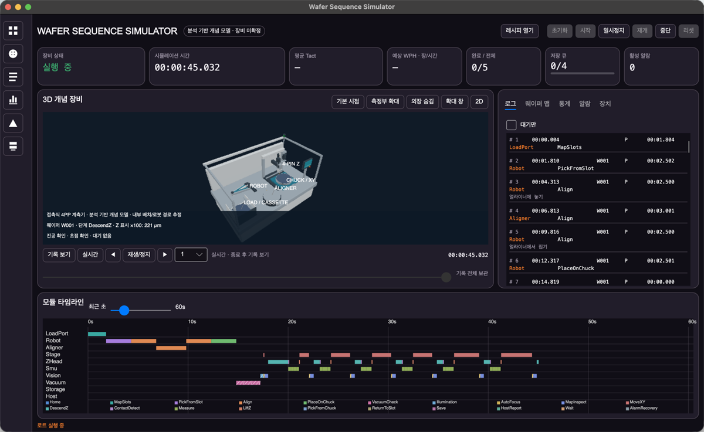 | 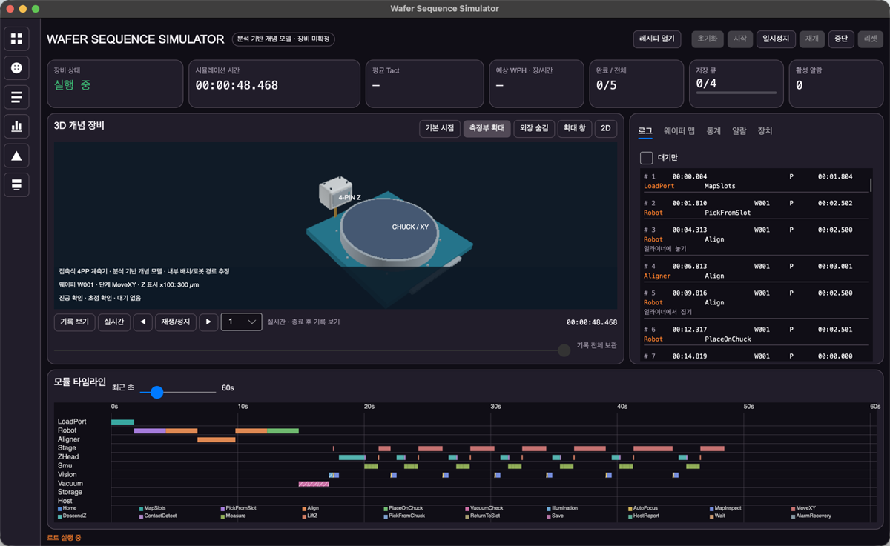 |
| 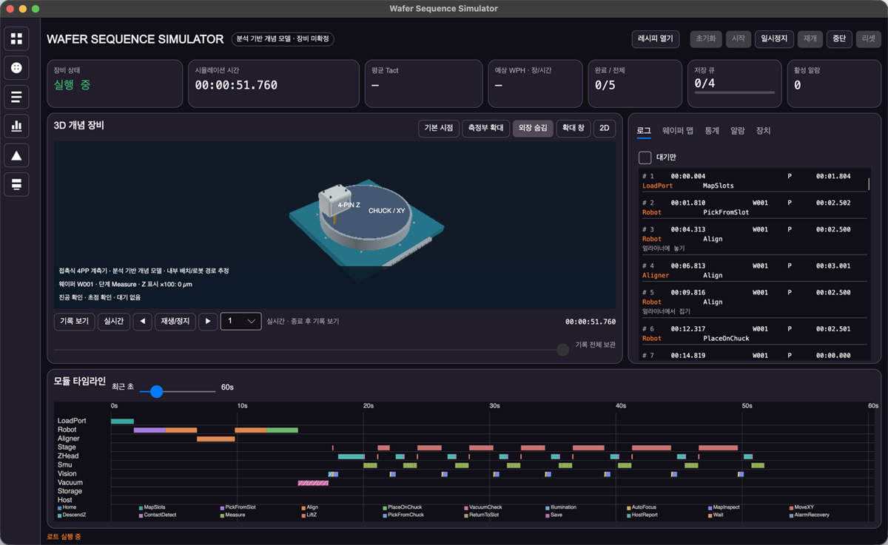 | 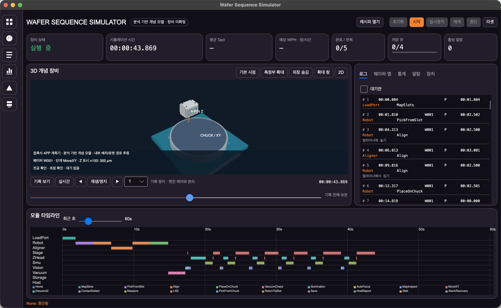 |


기본 중앙 화면은 **접촉식 4PP 계측기 · 분석 기반 개념 모델**이다. 3D 메시로 캐비닛, 적재 슬롯, 로봇 관절과 블레이드, 얼라이너, XY 스테이지와 진공 척, 4핀 Z 헤드, 카메라, 상태등을 그린다. 부품 배치는 시뮬레이터 모듈을 이해하기 위한 추정이며 실제 장비의 내부 구조나 크기를 뜻하지 않는다. 외장 형태는 공개된 [NAPSON WS-3000 제품 사진](https://www.napson-resistivity.com/products/contact/fullauto/product02/)의 흰색 캐비닛, 전면 적재부, 외부 조작부, 상태등을 일반적인 외형 참고로 삼았다(2026-10-12 확인). 브랜드나 특정 장비를 복제하지 않았다.

- Avalonia 실행: `dotnet run --project src/App.Avalonia/App.Avalonia.csproj`. Windows에서는 `dotnet run --project src/App.WinForms/App.WinForms.csproj`.
- 드래그로 회전하고 휠로 확대한다. 기본 시점, 측정부 확대, 외장 숨김, 2D 전환, 확대 창 버튼을 사용할 수 있다. 화면의 `Z 표시 ×100`은 실제 가상 Z 좌표를 미터로 변환한 높이보다 100배 크게 그린다는 뜻이다. 확대 창에는 좌우 회전·확대·축소·리셋 버튼도 있다.
- 실행을 마치거나 중단한 뒤 `기록 보기`를 누르면 타임슬라이더로 기록을 볼 수 있다. `실시간`으로 돌아갈 수 있고 기록의 정지와 재생은 구분된다. 기록 재생은 엔진에 명령을 보내지 않는다. 로그와 간트는 선택한 재생 시각을 따른다. 실행 중 조작 버튼은 실제 엔진 상태를 기준으로 한다.
- `13점 · 대기 누적`과 `13점 · 개선 가정`은 **가상 실험 예시**이며 실제 레시피나 분석 총시간의 재현이 아니다. 13개 위치는 중심·두 동심원에 추정 배치했다. 개선 예시는 진공 확인 3회는 유지하고 고정 대기, 사이트 간 Z 상승량, 맵 검사, 비동기 저장에 이미 구현된 설정만 적용한다. 접촉 실패·재시도는 그대로 기록된다. `UnloadOverlap`은 두 프리셋에서 끈다. 현재 엔진은 분리된 FOUP↔얼라이너 선행 반송만 XY/Z 계측과 중첩하도록 영역과 척 자원 잠금을 검사한다.
- 기록은 메모리에서 한 실행의 최근 30,000 스냅샷과 5,000 단계 이벤트로 제한된다. 새 실행과 리셋 시 비운다. 오래 실행하면 가장 오래된 기록부터 사라지며 UI에 잘림을 표시한다. 재생은 선택한 시각 이하의 마지막 스냅샷 상태를 유지하고, 이벤트·모션·표시 시각은 선택한 재생 시각을 따른다. 즉시 모드는 단계 경계 스냅샷을 별도로 기록한다.

### 상세 모델과 렌더링

기구 모델은 [Higgsfield 3D Jutsu](https://higgsfield.ai/3d-jutsu/d4899871-d2d7-4214-a28f-26b1049d0545) API에서 제작한 GLB를 사용한다. 25개 슬롯·4개 핀·레일·로봇 관절을 별도 부품으로 보존하고 가상 엔진 상태에 연결한다. 모델과 재제작 Python 소스는 `assets/equipment/`에 있다. 앱 실행에 Higgsfield 연결이나 API 키가 필요하지 않다.

움직임 중 면이 잘못 덮이던 평균 깊이 정렬을 픽셀별 깊이 버퍼로 교체했다. 정점 법선, 금속성·거칠기, 색 공간 변환을 반영하며 카메라 근접면을 지나는 삼각형도 잘라서 표시한다. 두 데스크톱 앱이 같은 모델과 렌더러를 사용한다. 제작 근거와 표현 범위는 [3D 참고 기록](docs/3d-reference-notes.md)에 정리했다.

렌더 이미지 면적은 창마다 81만 픽셀로 제한한다(예: 1600×900 창은 내부에서 1200×675로 렌더). revision 4의 20,916개 가시 삼각형을 사용한 로컬 Release 측정에서 800×500은 약 29.2ms, 1200×675는 약 45.7ms였다. 이는 비트맵 업로드·텍스트·화면 표시를 제외한 CPU 래스터 측정으로 실제 앱 FPS를 보장하지 않는다. 확대해도 기하 디테일은 유지되지만 현재 렌더러는 Blender 원본의 그림자·환경광 품질과 동일하지 않다.

### 가상 로봇 반송 상태

FOUP → 로봇 → 얼라이너를 높이 접근, 블레이드 진입, 접촉 인계, 보유 확인, 상승/하강, 후퇴의 실제 좌표 구간으로 구동한다. 명령당 `RobotMoveTime`을 각 구간에 배분하며, 가상시간에서 총 시간은 유지한다. 미터 단위의 현재/목표 좌표와 보유·재석 상태를 불변 스냅샷으로 전달하고, 3D와 기록 재생이 같은 자세를 사용한다. 소유권은 접촉면에서 한 번만 바뀐다. 중단하면 마지막 위치·보유 상태·확장 인터락을 유지하며 자동 수납하지 않는다.

Higgsfield 프로젝트 revision **7**의 기존 모델 보강본을 내장한다. 승강 가이드/캐리지, 얇은 블레이드, 관절 연결부, 얼라이너 패드/센서와 슬롯 눈금을 추가·수정했다. `RobotGeometry` 기준은 Y가 높이이며 슬롯 1 바닥 24 mm, 피치 6 mm, 얼라이너 패드 상면 120 mm, 블레이드 기준점에서 패드 상면까지 2 mm, 웨이퍼 두께 1 mm다. Mac/Windows에 한글 상태와 **반송 확대**를 제공하며 측정부 확대·별도 확대 창도 유지한다. 세부 로그는 `IsDetail`인 0시간 이벤트이므로 부모 반송 시간에 중복 합산되지 않는다.

참고: 로컬 영상 `DbIPBswvKzT`(슬롯 지지/재석 센서), `DdGdwxamfBE`(승강부와 수평 반송), 2026-10-13 프레임 시트 확인. 특정 실장비 복제가 아니다. 원격 편집 소스는 `build-transfer-details.py`, `refine-transfer-contact.py`이며 검수 기록은 `.review/transfer-detail/`에 있다. 기계적 충돌, 실제 센서/서보, 30 fps 성능 보장, Windows 런타임은 검증하지 않았다. `UnloadOverlap`의 척 접근 상호배제는 유지하고 분리 영역의 선행 반송만 허용한다.

## 제어 관찰성·장애 연습과 레시피 A/B 비교

오른쪽 **제어** 탭에서 인터락 조건, 4PP 단계·전압·편차·재시도와 통신/접촉 센서/DB 장애를 확인·조작한다. **실험** 탭의 기준 캡처→레시피 변경→비교 실행은 현재 로트를 유지하며 독립 엔진으로 같은 wafer/site/seed 조건을 계산한다. 비교 WPH는 완료 장수/실제 로트 경과시간 기준이다. 품질 판정은 `QualityEnabled`로 활성화하며 반복 샘플 편차(%)만 사용한다.

DB 장애 중 확보한 측정·실행·로그는 영속 저널로 보존하고 복구 버튼으로 중복 없이 재저장한다. 재생은 기록 관찰 전용이다. 분리 반송 영역과 품질 모델은 가상 가정이며 실제 충돌·장비 품질 보증이 아니다. [조작·수용 검사·알려진 한계](docs/control-upgrade.md)를 참고한다.

품질·접촉 불량이나 반송 중단 뒤에는 **안전 회수**로 센서·위치·소유권을 대조하고 원래 슬롯에 가상 웨이퍼를 반환한 뒤 다음 로트를 시작한다. 회수 없이 기존 웨이퍼를 덮어쓰지 않는다. **회수 중단**은 현재 위치를 보존한다. 비교의 불완료 WPH는 `— (불완료)`로 표시한다.

`WAFER_SIM_DATA`를 지정하면 SQLite와 복구 저널을 별도 폴더에 보관한다. 지정하지 않으면 OS LocalApplicationData의 `wafer-sequence-sim`을 사용한다. 확인 완료된 저널은 원본 그대로 `.archive-*`에 보관하고 새 active로 교체한다. 자동 삭제는 없으며 보존 기간·디스크 관리는 운영자 정책으로 남긴다. 마지막 줄 손상은 경고와 prefix 복구, 중간 손상은 앱 내 오류 표시 및 저장 차단으로 구분한다. 통신 복원 대기 120초는 벽시계, 접촉 센서 지연 5초는 가상시간이다. 품질 알람은 ALID 2003 `QualityRejected`이다.
